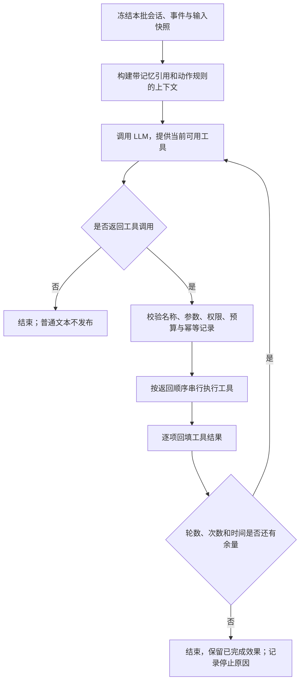

# 全工具调用协议方案

状态：用户已于 2026-11-13 授权实施，首版已完成本地实现；默认保留 legacy_json，真实模型灰度和默认切换尚未进行。编写日期：2026-11-12。

本方案取代运行工作区 `docs/beta-tool-mode-plan.md` 的“双通道 + 最终 JSON”提案。本文保留原始设计与验收目标。已实现的接口、运行边界和启用步骤以 [TOOL_PROTOCOL.md](TOOL_PROTOCOL.md) 为准；尚未完成真实灰度和正式切换。

## 1. 目标与范围

目标：LLM 通过工具表达所有会产生业务效果的操作。群聊发言、记忆修改、表情包收藏、命令学习不再依赖最后一段自定义 JSON。

工具参数和工具回执仍使用 JSON，这是函数调用协议本身的数据格式。取消的是“最终输出一个包含 reply/memory 等字段的大 JSON 对象”的业务协议。

工具模式满足以下约定：

1. 模型的普通 assistant 文本只作为内部结束信息，不直接发到群里，也不从中提取旧 JSON 执行动作。
2. 不发消息也是合法决策。可以只更新记忆，也可以整批无动作结束。
3. 同一批只运行一种协议。工具模式中不启用旧 reply/memory 回落；旧模式中不执行新增动作工具。
4. 命令调用、搜索、生图沿用既有能力与限制；本轮不扩展图片库、跨群代发、任意文件访问或自动执行新学命令。
5. 本体承担主要改造。peer HTTP 协议保持兼容，不在这一轮顺带开发远程结果关联。

## 2. 当前代码中必须迁移的职责

| 当前入口 | 实际职责 | 目标入口 |
| --- | --- | --- |
| 最终 reply | 文本、@、表情包 | send_message |
| memory.short_term / long_term | 列表的增删改 | query_memory / update_memory |
| memory.friends | 群友 info、aliases 增删改 | query_memory / update_memory |
| memory.culture | 术语、含义、语境、示例的增删改 | query_memory / update_memory |
| memory.save_meme | 从当前会话图片缓存收藏表情包 | save_meme |
| command_learning / command_edit / command_delete | 命令学习、编辑、删除置信度累计 | query_commands / manage_command |
| 入口发送回复 | UniMessage 拼装、发送、表情包计数 | 统一发送服务 |
| processor 的回复记录 | 目前在实际发送前记录历史、扣能量 | 移到真实发送结果之后 |

系统自动更新昵称、群名片、群归属、历史恢复、缓存清理仍由程序负责，不交给模型管理。

必须改造的底层行为：

- MemoryStore.apply_ops 当前多处捕获异常后只记日志，不能直接调用它并声称工具写入成功。
- CommandLearner 当前调度后台保存；工具“已保存”的确认必须等待持久化完成。
- MemeStore.resolve 当前查图就增加 usage_count 和 recent；工具预检不能继续产生这些副作用。
- 群友文件、命令库、表情包库跨会话共享，单会话串行不能替代这些资源的共享写锁。
- 异步生图当前读取 processor 的可变 bot/session；需要改为使用任务创建时的批次上下文。

## 3. 运行模型



### 3.1 BatchContext

每批创建一个上下文，贯穿所有轮次、参数纠错和后台任务：

- batch_id：程序生成；模型不能覆盖。
- bot、session、发送 target、真实事件模板、默认调用用户：开始处理时固定。
- 本批新消息和其 message_ref，例如 m1、m2；历史消息与新消息明确区分。
- 模型、工具集、配置快照、开始时刻和 monotonic deadline。
- 工具次数、命令尝试额度、发送尝试额度、记忆修改额度及已接受的生图任务。
- 工具回执、效果记录、停止原因。

“固定”表示后续消息不能替换这些依据；预算和执行状态由程序更新。后台生图持有原批次的上下文，不读取后续批次的 processor 字段。新消息留给下一批，不修改正在运行的 LLM 对话。

### 3.2 轮次与收尾

建议默认允许 **3 轮工具执行**。每轮为一次完整 LLM 返回及其工具执行；一轮可以有多个工具调用。

- query_memory → update_memory → send_message 可以在 3 轮内完成。
- 信息已经在 prompt 中时，可在同一轮安排独立的记忆操作和发言；需要确认“已经记住/修改成功”的话，应收到写入回执后再在下一轮发送。
- 模型不返回 tool_calls 即结束，无需额外 finish 工具。
- 最后一轮工具执行完就结束，不再发起一个“去掉 tools、强求最终 JSON”的请求。
- 不从最后的普通文本补发群消息。模型漏用发送工具时记录指标，不通过隐式发送纠正。
- 不把成功发送自动设为结束条件；模型还可以在剩余预算内整理记忆。重复发送由发送额度与幂等规则阻止。

默认每轮执行最多 4 个工具调用、每批最多 12 次，包含错误参数和前置拒绝的调用。超出的调用回填明确的预算错误，不执行。再次请求 LLM 前，为该 assistant 消息中的每个 tool_call_id 补齐回执，避免损坏协议序列。

### 3.3 时间和错误

- 建议整批墙钟上限 180 秒，单次 LLM 请求上限 60 秒，并受剩余整批时间约束。SDK 内部重试和等待也计入该上限。
- 工具超时以原功能配置和剩余时间中的较小值为准；内存/存储操作不沿用外部 API 的长超时。
- 工具参数使用严格类型校验。JSON 无法解析、必填缺失或字段非法时返回参数错误，不用空参数代替，也不猜测修复具有副作用的参数。
- 可纠正错误通过回执进入下一轮；不重新运行整批，也不重放已经执行的工具。
- 超时、取消、连接中断是否允许重试，取决于具体效果状态，不能统一视为没有执行。
- Python 3.10 必须能运行；超时实现不依赖仅在高版本 Python 提供的语法/API。
- 第一版不执行流式输出中的半成品工具调用；必须收到完整调用并通过校验后才执行。

## 4. 工具集

最大工具集为 10 个，按配置和命令清单动态注入，不给每个记忆字段单独建立工具。

| 工具 | 行为 | 默认注入条件 |
| --- | --- | --- |
| send_message | 立即向本批会话发送消息 | 工具协议启用 |
| query_memory | 查询记忆及可编辑条目引用 | 记忆工具启用 |
| update_memory | 修改一个目标集合 | 记忆工具启用 |
| save_meme | 从本会话缓存收藏表情包 | 表情包功能启用 |
| query_commands | 查询已学习命令，包括尚未达到置信度的记录 | 命令学习启用 |
| manage_command | 学习、编辑、申请删除命令 | 命令学习启用 |
| search_internet | 联网搜索 | 搜索启用且客户端就绪 |
| invoke_plugin | 本机命令投递 | 调用启用且本机清单非空 |
| invoke_peer_plugin | peer 命令投递 | 调用启用且 peer 清单非空 |
| generate_image | 创建异步生图任务 | 生图启用且客户端就绪 |

禁用记忆工具表示不让模型修改记忆，不切回 JSON。自动更新昵称/群名片等系统行为另行保留。

每个工具都由服务端固定会话范围；schema 不暴露任意 session、发送对象、文件路径。调用命令时现有显式 user_id 能力保留，仍受已有规则约束。

### 4.1 通用回执

回执建议包含：

```json
{
  "ok": true,
  "status": "committed",
  "code": "MEMORY_UPDATED",
  "request_id": "程序生成的效果编号",
  "data": {},
  "warnings": []
}
```

ok 表示该工具请求达到其声明的目标，不统一等同于外部命令执行成功。status 保留各领域的准确语义：

- 查询：ok / not_found。
- 存储：committed / unchanged / conflict / failed。
- 消息：sent / partial / not_sent / uncertain。
- 命令投递：沿用 not_sent / accepted / dispatched / uncertain。
- 生图：accepted + job_id；它不是图片已生成或已发送。

同一工具的批量结果还必须给出逐项状态。模型不能只看顶层 ok 忽略 partial 或 warnings。

回执由后端序列化为 tool 消息。读工具分页并限制输出体积；写工具回执保留目标、实际改动和错误，不通过粗暴截断丢失关键状态。

## 5. send_message

### 5.1 参数

```json
{
  "messages": [
    {
      "key": "reply_1",
      "parts": [
        {"type": "at", "target": "10001"},
        {"type": "text", "content": "记住了，下次按这个来。"}
      ]
    },
    {
      "key": "reaction_1",
      "parts": [{"type": "meme", "id": "已存在的表情包id"}]
    }
  ]
}
```

- key 是本批内该逻辑消息的幂等键；相同 key、相同内容重试返回原结果，不再次发送。相同 key 换内容返回冲突。
- target 可以是用户 id 或可唯一解析的名字；建议优先使用上下文提供的用户 id。无法解析或同名歧义时明确拒绝该次预检，不静默丢掉 @。
- 只接受 text、at、meme。图片路径和任意 URL 不由模型填；表情包 id 必须存在且文件可用。
- 每次调用先预检全部 messages，再用统一拼装服务展开为实际待发送单元。任何参数错误、无效表情包或超额度都在首条发送前拒绝。执行前预留所需名额，中止后释放尚未尝试的单元；已尝试部分不退还额度。
- 图片段可能将文本拆成多条，因此额度按展开后的实际发送单元计，不按 messages 数组长度计。
- 默认每批最多 3 次实际发送尝试；一次确定未发送的网络尝试也占额度，防止循环轰炸。参数预检失败不占发送额度，但占工具调用额度。
- 文本长度及段数设后端上限，第一版建议单个逻辑消息文本总长 2000 字符、最多 20 段，超出返回错误，不静默截断。

### 5.2 部分发送与不可确定结果

实际发送依次执行，逐单元记录：

| 状态 | 判据 | 后续动作 |
| --- | --- | --- |
| not_sent | 尚未发出网络请求，或已明确被拒绝 | 不写“已发送”聊天历史；允许模型在额度内修正 |
| sent | 适配器调用成功返回；有平台回执时一并保存 | 立即记录真实发言并结算能量 |
| uncertain | 发出后超时、取消或丢失回执，无法确认 | 保留尝试记录，不自动重发同一单元 |
| partial | 同一次工具中部分 sent，其余失败/未知 | 回执逐项列出；禁止整体重试已发部分 |

sent 表示适配器报告发送成功，不宣称消息已被用户阅读或平台后续一定展示。明确平台异常如何分类由适配器错误映射决定，未知异常采取 uncertain。

某条进入 uncertain 后停止该工具剩余发送，避免后半句先于前半句到达。未执行单元标记 not_attempted，不伪造发送成功。

### 5.3 幂等与日志

- 工具结果缓存按 batch_id + tool_call_id 保存。相同调用 id 携带不同参数时拒绝。
- send_message 还按 batch_id + message.key + 展开单元序号记录效果；不同 key 的完全相同标准化内容在同批内也去重。
- 跨批普通文本去重默认关闭：不同用户先后得到“好的”可能是合理回复，不应被统一的 60 秒窗口压掉。
- 为发送建立轻量效果记录：发送前保存 intent，返回后保存 sent/not_sent/uncertain。记录写入失败时不继续发送。
- 进程恢复时，只有 intent 而无结果的单元视为 uncertain，不自动补发。记录设置保留期限和清理规则。
- 平台没有幂等接口时不能承诺端到端 exactly-once；本方案保证不主动重放已确认或结果未知的发送。
- 效果记录不能无期限复制全部聊天正文；默认保存编号、摘要/哈希和状态，正文仍走原有历史保留策略。

### 5.4 历史、能量和表情包

- 只有 sent 的内容写作机器人的实际发言；发送失败不能提前写成“已经说过”。
- uncertain 写入诊断/动作状态，不作为确认发言；能量可按尝试保守结算一次，后续确认不重复扣。
- 同批回复基础能量消耗只计算一次，文字消耗按累计成功发送的字符重新计算差额，避免分三次发被重复收三份基础成本。
- 表情包查询改为只读 lookup，发送成功后再增加 usage_count。uncertain 保留防重复状态，但不冒充确定的使用次数。
- 表情包当前跨群 recent 策略继续保留，不顺带改变其共享范围。

### 5.5 异步生图

保留 generate_image 的后台任务行为，避免 LLM 阻塞等待长时间生成：

1. 接收任务时固定 BatchContext，并预留一个本批发送尝试名额。
2. 回执只返回 accepted、job_id 与说明。
3. 完成后通过同一个发送服务发布图片，使用原任务的会话和额度；不读取后续批次身份。
4. 已接受任务可在 LLM 回合结束后继续完成，受独立任务超时约束；失败不会触发整批重跑。
5. 由工具发起的图片发布属于允许的后台效果；普通模型文本仍不能绕过 send_message 发布。

本机/peer 目标插件自己的输出不受本体 send_message 额度控制，继续由现有命令额度限制其发起次数。

## 6. 记忆工具

### 6.1 查询

```json
{
  "target": "friend_info",
  "owner_id": "10001",
  "keyword": "咖啡",
  "limit": 20
}
```

target：short_term、long_term、friend_info、friend_aliases、culture。

- owner_id 仅对群友目标必填，必须能映射到当前会话已知成员；不按一个模糊昵称创建新文件。
- 查询返回 entry_id、内容、该集合的 revision、分页信息；不返回可写文件路径。
- 默认返回最多 20 条，上限 50 条。文化记忆返回 term/meaning/context/usage_examples。
- 群友系统字段可以在摘要中展示，但不可通过 update_memory 改写：昵称、群名片、曾用名、群归属仍由系统更新。
- 普通短期/长期记忆摘要和可用条目引用保留在首轮 prompt，避免每次聊天都多查询一轮；完整内容按需查询。

### 6.2 写入

```json
{
  "target": "friend_info",
  "owner_id": "10001",
  "expected_revision": "r_17",
  "operations": [
    {"action": "modify", "entry_id": "mem_abc", "value": "偏好不加糖的拿铁"},
    {"action": "add", "value": "周末通常有空"}
  ]
}
```

- 一个调用只修改一个目标集合，不支持跨文件事务。
- action 为 add、modify、delete；modify/delete 必须使用服务端提供的 entry_id，不接受裸数组下标。
- expected_revision 必须与当前目标集合一致；过期时返回 conflict，要求重新查询，不猜测位置，也不偷偷模糊匹配。
- 第一版每调用最多 20 个操作，每批最多 40 个实际修改条目。额度独立于发送和命令额度。
- 对同一 entry_id 的冲突操作、未知 id、空内容、重复术语等在写入前全部校验；该集合全成功或全不变。
- 同内容 add 返回 unchanged；修改内容相同也不重复写。一次操作的重试不会重复增加条目。
- 文化记忆允许修改业务字段，first_seen、usage_count 等统计由程序维护。重复收藏术语不作为多次真实使用证据。
- 返回变更前后摘要、新 revision、生成的 entry_id；只在原子持久化成功后返回 committed。

### 6.3 条目身份与文件兼容

不把现有字符串列表全部改成对象列表。原 items/facts/info/aliases/terms 保留，在各 JSON 根增加保留字段 `_aigfm_meta`，记录各可编辑集合的：

- schema_version；
- revision；
- 与当前列表对齐的持久 entry_id；
- 内容校验哈希，用来识别外部旧代码或手工修改。

正常修改保留未删除条目的 id，修改内容不更换条目 id；新条目由程序生成 id。昵称/群名片更新不使无关的 info/aliases revision 失效。

迁移前备份，按文件加锁，原子写入元信息，业务内容和顺序不变。发现元信息与实际内容不匹配时保留内容、重建身份并更新 revision，旧引用全部失效；不能按旧下标强行套回 id。

模式切换和原版本回退都不能继续使用切换前的未完成工具上下文。旧代码忽略或移除元信息后，再回工具模式需要重新建引用，不能复用旧 revision。

### 6.4 共享群友与跨适配器身份

当前 friends 目录在全实例共享，并使用裸用户 id 命名。这与跨适配器用户 id 可能重合的问题直接相关，工具不能允许任意 id 读写而扩大这个问题。

建议在记忆适配层明确 (adapter_slug, user_id) 身份：

- 已能确认属于 OneBot V11 的原有数字 id 文件保留原路径，继续兼容。
- 其它适配器的新记录使用 `friends/<adapter_slug>/<安全编码的用户标识>.json`；工具仍只看原生 owner_id，路径由程序生成。
- 原有记录通过其 groups 会话归属判定可迁移身份；归属混合或不明确时保留原文件并列入迁移报告，不自动归给某个适配器。
- 不明确记录不允许工具直接覆盖；新模式按明确身份建立记录，旧文件保留供后续人工映射。
- 同一适配器的群友仍按当前设计跨群共享。此次不把好友 info 全部改成按群独立存储。

这项属于存储适配与迁移，不要求重做所有历史内容。迁移必须有预览报告、备份和可核对的记录数，不能以启动时无提示重写代替验收。

### 6.5 并发与提交

- 使用共享的 StoreCoordinator 按规范化文件路径加锁；不能每个 MemoryStore 实例各建一把互不相干的锁。
- 锁覆盖读 → revision 检查 → 修改 → 原子落盘，完成后才释放；不能只给写文件那一步加锁。
- update_nickname/update_card 等自动更新、旧 JSON 模式写入也必须使用同一规则，否则仍会丢掉并发修改。
- 临时文件写好后原子替换目标文件。取消/崩溃发生在提交边界附近时重新读取 revision/效果记录判断，不能统一报告没写入。
- 查询不修改业务数据；身份初始化作为协议切换/批处理准备完成，不让一个查询工具偷偷增加记忆条目。
- 一个 update_memory 只操作一个集合，因此无需承诺多个文件同时提交或网络发送与记忆提交的统一事务。

## 7. 表情包收藏与命令学习

### 7.1 save_meme

参数：cache_id、description、keywords。

只允许当前会话缓存中仍有效的 id，历史跨批缓存继续可用。明确返回 saved、already_exists、cache_missing、failed；不能把现在的静默跳过包装成成功。

图片文件与索引写入由 MemeStore 管理共享锁。先准备文件，再原子提交索引；索引失败时不能返回 saved，孤立文件交由清理流程处理。模型不能传目录或磁盘路径。

### 7.2 query_commands / manage_command

query_commands 提供 route=current/peer、source、name 过滤，返回已学习记录、置信度、删除置信度及可用状态；不因低置信度而从查询结果中隐藏记录。

manage_command 使用 action=learn/edit/request_delete，以及 route、source、name、parameters、usage、examples、evidence_refs 等字段：

- learn 仍沿用多次观察达到阈值才进入可调用清单的机制。
- request_delete 仍是累计删除置信度，回执区分 pending_delete 与 deleted，不引入模型直接硬删除入口。
- 同一批对同一命令的重复学习/申请删除不累计多次置信度；evidence_refs 必须引用本批真实新消息，不能反复引用同一条历史记录刷阈值。
- 编辑和删除必须明确 current/peer 与来源，不再使用“本机有同名就先改本机”的隐式选择。
- 当前底层字典不能表达的同名多来源冲突返回 COMMAND_SOURCE_CONFLICT，不覆盖另一来源；完整命令存储键重构不夹带到这轮。
- 继续拒绝自家管理命令和不可调用命令的错误学习；学习成功不改变插件调用白名单和权限核对。
- 保存改成可等待的异步提交，committed 后才更新可见状态。跨会话修改由同一 learner 锁和原子文件保存保护。

## 8. 工具执行规则

### 8.1 预算相互独立

| 预算 | 建议默认 | 计数范围 |
| --- | --- | --- |
| 工具执行轮次 | 3 | 一次 LLM 返回及其工具执行为一轮 |
| 每轮工具调用 | 4 | 超出项回填拒绝，不执行 |
| 每批工具调用 | 12 | 所有工具，含参数错误和前置拒绝 |
| 整批墙钟 | 180 秒 | 包括 SDK 重试、工具和存储等待 |
| 命令尝试 | 现有默认 1 | invoke_plugin + invoke_peer_plugin，跨轮共享 |
| 发送尝试 | 3 | 展开后的实际消息，含生图预留 |
| 记忆修改 | 40 条 | 每工具最多 20 个操作 |

使用工具去重不代替预算，预算也不代替去重。失败后反复换 tool_call_id、消息 key 或命令参数都不能重置本批额度。

### 8.2 执行顺序

第一版全部工具按模型返回顺序串行执行，便于确定效果顺序；可以请求服务商不要并行返回调用，但服务端串行执行才是保证。

同一响应里的后一个调用不能假定自己已经看见前一个调用结果。依赖查询结果的修改、依赖写入成功的确认应放到下一轮；参数中不存在的引用不做变量替换。

为防止参数已经排好的错误确认消息，增加执行层规则：同一 assistant 响应中发生工具失败、写入冲突或结果不确定后，剩余 send_message 暂不执行，回填 DEPENDENCY_RESULT_REQUIRED，等待模型在下一轮看见真实结果后重新组织发言。未发送部分不占实际发送额度，但占已收到的工具调用额度。这不撤销此前已经发送的消息，也不能替代模型遵守先确认再宣称成功的指令。

某个调用参数错误不会撤销已成功的独立调用。回执完整记录每个结果，模型在下一轮决定是否还需要动作。跨资源没有隐式整体回滚。

### 8.3 动作幂等与恢复

- 读操作可重试；写操作、发送、命令投递按各自效果记录处理。
- 重复 tool_call_id 返回已有回执；同批相同语义写操作也应识别为重试，不能再次增加计数或置信度。
- 已提交记忆即使随后 LLM 失败也保持有效，不回滚真实世界已产生的效果。
- 已接受/已投递/不确定命令沿用现有台账，不因多轮或模式错误重置。
- 重启不自动继续发送或执行上一批副作用；未完成记录只恢复为待核对状态。
- `/reset` 清理本会话上下文及调用台账，延续当前记忆保留语义；效果记录保留必要的不确定发送证据。对已接受的后台生图增加会话 generation 标记，reset 后禁止旧任务再自动发布到群，最终生成结果可只记任务状态。

## 9. Prompt 与模型兼容

工具模式 prompt 删除最终 JSON 示例、reply/memory/command_learning 输出字段指令，改为：

- 要在群里说话必须调用 send_message；普通结束文本不会发布。
- 要记住、修改或删除内容必须调用对应工具；不确定引用时先查询。
- 沉默是允许的，不要求每批至少发一次消息。
- 收到外部命令投递回执不等于命令执行完成；没有输出也不自动重试。
- 不把工具错误回执当作用户消息，不在群里复述内部堆栈或整段工具数据。
- 关注当前剩余额度；动作足够完成意图后就结束，不为了用完轮次继续调用。

保留角色、社交能量、来源标注、最近聊天记录、会话启用、已有命令边界和图片 id 锚点。短期/长期记忆条目展示 entry_id 和 revision，完整查询工具用于补充而非每次强制查询。

工具模式不传旧 response_format=json_object，不受 aigfm_llm_json_mode / aigfm_llm_tools_json_strict 控制；这两个配置仅在旧协议有效并给出弃用提示。

模型必须支持工具调用。服务商拒绝 tools 时明确报协议不兼容、停止本批，不自动退回旧 JSON 或发送普通文本。是否切回旧模式由管理员显式配置，不在半批执行后切换。

## 10. 模块调整

| 模块 | 调整 |
| --- | --- |
| llm_client.py | 增加多轮会话传输；保留完整 assistant/tool 序列；不承担存储和发送业务 |
| tool_runtime.py（新） | BatchContext、轮次/deadline、执行预算、回执、幂等调度 |
| tool_schemas.py（新） | 工具参数模型、schema 导出、统一校验 |
| tool_handlers.py（新） | 将工具参数映射到现有 clients/stores/sender，避免 processor 再膨胀 |
| message_sender.py（新） | 发送预检、实际展开、逐条发送、效果记录、历史/能量/表情包结算 |
| effect_store.py（新） | 发送意图和结果的持久化、恢复与清理；不伪造平台完成确认 |
| memory_store.py | 稳定条目引用、revision、原子读改写、群友身份适配和明确提交结果 |
| command_learner.py | 明确来源、可等待持久化、并发与重复观察限制 |
| meme_store.py | 只读查询与使用结算分离、结构化收藏结果 |
| processor.py | 继续组装上下文；按协议调用一个流程；不同时解析两套动作 |
| prompt_builder.py | 共享上下文构建，按协议选择动作说明，分离旧 JSON 输出段 |
| response_parser.py | 暂留给 legacy_json；工具参数使用 schema 校验，不复用宽松 JSON 修复 |
| __init__.py | 入口负责组装 sender/runtime；工具模式不再把最终返回值当 reply 发送 |

process 返回一个 ProcessResult（协议、停止原因、轮次、工具数、效果摘要），不再靠 None 区分“正常沉默”和“请求失败”。兼容期 legacy 分支也用同一外层结果类型包装回复，避免入口猜测。

统一发送服务应先被旧发送路径复用，再用于工具，以免留下两套历史/能量/表情包计数规则。新模式启用后入口不会重复发送。

## 11. 建议配置

以下仅为提案，命名在实现前统一校对：

| 配置 | 建议值 | 说明 |
| --- | --- | --- |
| aigfm_action_protocol | tools / legacy_json | 开发阶段保持旧模式；整体验收后的新 beta 默认 tools |
| aigfm_llm_max_tool_turns | 3 | 允许执行工具的 LLM 轮次数 |
| aigfm_tool_max_calls | 12 | 整批所有工具调用上限 |
| aigfm_tool_batch_timeout | 180.0 | 整批墙钟上限 |
| aigfm_tool_send_max_messages | 3 | 实际发送尝试数，含异步生图预留 |
| aigfm_tool_memory_enabled | true | 新协议记忆读写开关 |
| aigfm_invoke_max_per_batch | 保留现值 | 既有命令尝试额度，贯穿所有轮次 |

单轮 4 调用、记忆每次 20/每批 40 条、长度和分页限制先作为具名常量，不立即增加大量配置项。旧模式不接受新动作工具，新模式关闭某个工具不启用相应 JSON 通道。

## 12. 实施阶段与可审查交付

| 阶段 | 交付 | 启用条件 |
| --- | --- | --- |
| A：运行底座 | BatchContext、多轮调度、参数校验、通用回执、统一 sender 与效果状态；新协议尚不默认启用 | mock LLM 的循环/预算/取消/重放测试通过 |
| B：存储接口 | 记忆 id/revision、共享锁和原子提交；群友身份迁移预览/备份；命令库可等待提交；表情包查找与计数分离 | 原数据语义不变、冲突与恢复测试通过 |
| C：完整工具集 | send、memory、meme、commands 全覆盖；新 prompt；异步生图接入 sender；tools 模式可以完整替代 JSON | 功能映射表无遗漏，同批没有双通道 |
| D：离线与灰度 | 旧模式回归、工具模式回归、适配器矩阵；指定模型和会话真实验证 | 消息/记忆无重复、无错误成功回执、可解释停止 |
| E：切换与清理 | 新 beta 默认 tools；明确兼容窗口；验证后删除旧模式、旧配置和最终 JSON 解析入口 | 用户确认灰度效果，另行授权提交/发布 |

这些是开发阶段，不强行对应 b6/b7/b8 版本号。A/B 可以独立审查，但不把缺失记忆或命令学习的新模式作为完整替代版本交付。

回退规则：只在新批次开始前显式切换协议，已执行效果不回滚、不重放。回退到上一个二进制版本前先备份；新好友命名空间的数据需要兼容导出/映射，不能声称旧二进制天然能看到所有新记录。

## 13. 验收清单

### 13.1 协议和循环

- query → update → send 多轮链完成；无工具时合法结束；到轮次上限后没有额外最终 JSON 请求。
- 普通文本、包含旧 reply/memory 的文本都不产生群消息或记忆操作。
- 多调用按顺序执行；未知工具、非法 JSON、非法类型、超限项都有对应回执。
- 首轮/中间轮网络失败、超时、取消、SDK 重试都受同一 deadline 约束。
- 写入失败/冲突后同一响应里预先安排的“已记住”不发布；下一轮依据失败回执生成说明。
- 本机/peer 命令额度跨轮共享；既有去重、能量、管理命令拒绝和白名单不退化。

### 13.2 发送与后台任务

- 文本、@、表情包、混合拆条；实际发送数限制；无效 @/素材在首发前被拒绝。
- 部分发送、丢失回执、取消、保存 intent 失败；不重复发已成功或结果未知的单元。
- 不同 tool_call_id 或 key 重复同内容仍在同批去重；新批合理的同一句回复不被误压制。
- 发送前不记录真实发言；一次批次只结算一次基础能量，表情包不在预检时增加使用次数。
- 生图任务持有原会话、预留额度；批次超时与 reset 不把旧图发给新会话或继续发布已失效任务。
- 重启恢复未完成 intent 为 uncertain，不自动补发。

### 13.3 存储与学习

- 所有旧 JSON 职责都有工具替代，包括 aliases、culture、save_meme 和命令删除置信度。
- entry_id 修改后保持稳定；删除、重排、外部编辑后旧 revision 不会误改另一条。
- 同文件批量操作全成或全不变；不同文件不伪称整体事务。
- 两个会话并发更新同一个群友，同时系统更新昵称/群名片，不发生覆盖丢失。
- 不同适配器同名原生 user_id 不串数据；不明确旧记录不自动覆盖。
- 命令同名来源冲突明确返回错误；同批重复学习/删除不刷置信度；持久化失败不返回 committed。
- 表情包重复收藏、缓存过期和索引写失败得到准确回执。

### 13.4 回归与上线

- 当前 Python 3.10/3.14 离线回归继续通过。保留旧协议测试；新增工具模式测试覆盖同等能力，不用“返回空 reply”代替测试工具发送。
- 重跑消息/调用 187 项与通知 17 项矩阵，并增加工具 sender 跨适配器用例；旧矩阵通过不等于新 sender 自动通过。
- 本体/peer 运行副本同步、wheel 包内容正确。
- 真实模型灰度验证普通回复、主动沉默、记忆纠错、插件慢响应、部分发送失败和重启；观察普通文本被忽略率、轮数、费用/延迟、重复效果与不确定状态。
- 灰度至少覆盖一个日常使用周期；建议连续 24 小时，无重复发送、无记忆误改、无错误成功回执，再讨论默认切换和发版。

## 14. 三个行为示例

### 14.1 群友说“记住我喝咖啡不加糖”

1. prompt 已有该群友条目和 revision 时，第一轮直接 update_memory；没有就先 query_memory。
2. 回执 committed 后，下一轮 send_message 发“记住了”。
3. 若写入失败或 revision 冲突，不能发“记住了”；模型可重查后修改，或者说明暂时没记上。
4. 普通最终文字不会再补发一次回复。

### 14.2 群友说“帮我查一下今天的小猪”

1. invoke_plugin 发起命令，沿用每批 1 次的额度。
2. 回执只是 dispatched，本批可以直接结束，等待后续插件输出进入新消息。
3. 即使工具循环还剩两轮，也不能再投一次，或凭空补一句具体查询结果。

### 14.3 连发文本与表情包时第二条超时

1. sender 预检并展开，第一条成功写入 sent 和真实聊天历史。
2. 第二条发出后超时标为 uncertain，停止余下发送。
3. 模型下一轮能看到第一条已发、第二条未知、剩下未尝试；不整体重发。
4. 重启也不会自动重放未知发送，已提交的记忆同样不会因为本批中止而回滚。

## 15. 推荐定案

推荐采用：**最终单工具协议、兼容期整批二选一、默认 3 轮、最多 3 次实际发送、记忆用持久 id + revision、命令学习与表情包收藏同时迁移、失败不整批重跑**。

当前尚未做真实模型/平台联调，所以费用与延迟变化不做数字承诺。开发先完成可验证的完整替代，再以灰度结果决定是否调整默认轮数及保留旧模式的时长。
